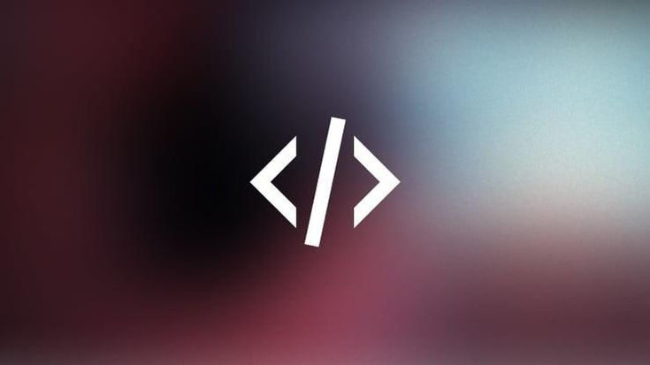

  

<h1 align="center">Hi 👋, I'm Allyson</h1>
<h3 align="center">High School Student & Aspiring FullStack Developer</h3>

---

### 👨‍💻 About Me

- 🎓 I'm currently a high school student with a strong interest in **programming** and **technology**.  
- 🚀 I'm actively learning and practicing **Python**, **JavaScript**, **C++**, and **Cloud Services** fundamentals.  
- 💡 I enjoy discovering new technologies, building projects, and challenging myself to grow as a developer.  
- 🌱 My goal is to keep improving and explore more areas in the tech world, from web development to cloud computing.  
- 🙌 Thanks for visiting my profile!

---

### 🛠️ Tech Stack

  
  
  
  
  
  
  
  
  
  
  

---

### 📊 GitHub Stats

  
  

  

  

---

Made in Brazil 🇧🇷

